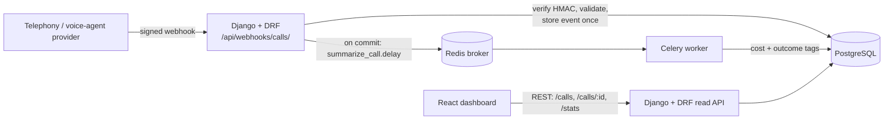

# callflow-analytics-api

[](https://github.com/Vedansh-0611/callflow-analytics-api/actions/workflows/ci.yml)

A Django REST Framework service that ingests call-event webhooks from a voice / telephony
provider (for example an AI voice agent platform), stores every call with its event timeline,
and computes per-call cost and outcome tags in a Celery worker.

**Frontend:** [callflow-dashboard](https://github.com/Vedansh-0611/callflow-dashboard)
([live demo](https://vedansh-0611.github.io/callflow-dashboard/)) visualizes the data this API serves.

**Stack:** Python 3.12, Django 5.1, Django REST Framework, Celery, Redis, PostgreSQL (SQLite for
local dev), pytest, Docker Compose, GitHub Actions.

## What it does

- `POST /api/webhooks/calls/` accepts four event types: `call.started`, `transcript.chunk`,
  `tool.called`, and `call.ended` (with duration and LLM token usage).
- Every request must carry a valid **HMAC-SHA256 signature** and a recent timestamp.
- Events are **idempotent** on `event_id`, so provider retries never create duplicates.
- When a call ends, a **Celery task** computes its cost from a configurable price table
  (LLM tokens + per-minute telephony) and derives outcome tags such as `resolved`,
  `transferred`, `voicemail`, `tool_failed` and `booking_made`.
- Read API: paginated and filterable call list, call detail with the event timeline, and
  aggregate stats (calls per day, average duration, cost per day, tag counts).

## Architecture



Request flow for one `call.ended` webhook:

1. Verify `X-Webhook-Signature` against `"<timestamp>.<raw body>"` and reject stale timestamps.
2. Validate the JSON body with a DRF serializer.
3. In one transaction: get or create the `Call`, lock its row, skip if the `event_id` already
   exists, store the `CallEvent`, update the call (duration, tokens, status).
4. After the commit, enqueue `summarize_call`. Respond `202 Accepted` right away.
5. The worker loads the call and its events, computes cost and tags, and saves them.

## Data model

| Model       | Key fields                                                                                   | Indexes                                                             |
|-------------|----------------------------------------------------------------------------------------------|---------------------------------------------------------------------|
| `Call`      | `provider_call_id` (unique), agent, direction, numbers, status, started/ended, duration, end reason, model, tokens, `cost_usd`, `outcome_tags` | `started_at`, `(status, started_at)`, `(agent_id, started_at)` |
| `CallEvent` | `event_id` (unique), `call` FK, `type`, `occurred_at`, `data` (JSON)                          | `(call, occurred_at)` for the timeline                               |

## Running it

### Option 1: Docker Compose (web, worker, Postgres, Redis)

```bash
cp .env.example .env          # optional, compose has sane defaults
make up                       # docker compose up --build -d, then seeds demo data
make webhook                  # send a signed sample call through the full pipeline
make logs                     # watch the web and worker logs
```

The API is on http://localhost:8000/api/.

### Option 2: Local virtualenv (SQLite, no Redis needed)

```bash
make install                  # python3 -m venv .venv && pip install -r requirements-dev.txt
cp .env.example .env          # then set CELERY_TASK_ALWAYS_EAGER=true to skip the worker
make migrate
make seed                     # 200 fake calls over the last 14 days
make run                      # http://localhost:8000
```

To use a real worker instead, keep `CELERY_TASK_ALWAYS_EAGER=false`, start Redis, and run
`make worker` in a second terminal.

### Tests

```bash
make test                     # pytest, SQLite + Celery eager mode
```

CI runs the same suite against PostgreSQL 16, checks for missing migrations, and then boots
the full Docker Compose stack and sends signed webhooks end to end.

## API

| Method | Path                       | Description                                                                 |
|--------|----------------------------|-----------------------------------------------------------------------------|
| POST   | `/api/webhooks/calls/`     | Ingest one event (signed)                                                  |
| GET    | `/api/calls/`              | List calls. Filters: `status`, `agent_id`, `direction`, `end_reason`, `started_after`, `started_before`, `min_duration`, `max_duration`. Also `search`, `ordering`, `page`, `page_size` |
| GET    | `/api/calls/<call_id>/`    | Call detail with its event timeline                                        |
| GET    | `/api/stats/?days=14`      | Totals, per-day series and outcome tag counts (1 to 90 days)               |
| GET    | `/api/health/`             | Health check                                                               |

If `API_KEY` is set, read endpoints require an `X-API-Key` header. Webhooks always use the
HMAC signature instead.

### Sample requests

Sending a signed webhook with curl and openssl:

```bash
SECRET=local-dev-secret
BODY='{"event_id":"evt_001","type":"call.started","call_id":"call_demo_1","timestamp":"2026-01-10T10:00:00Z","data":{"agent_id":"clinic-receptionist","direction":"inbound","from":"+919800000001","to":"+918000000000"}}'
TS=$(date +%s)
SIG=$(printf '%s.%s' "$TS" "$BODY" | openssl dgst -sha256 -hmac "$SECRET" | awk '{print $NF}')

curl -X POST http://localhost:8000/api/webhooks/calls/ \
  -H "Content-Type: application/json" \
  -H "X-Webhook-Timestamp: $TS" \
  -H "X-Webhook-Signature: sha256=$SIG" \
  -d "$BODY"
# {"status":"accepted","event_id":"evt_001"}   (send it again: {"status":"duplicate"})
```

A `call.ended` event carries usage:

```json
{
  "event_id": "evt_005",
  "type": "call.ended",
  "call_id": "call_demo_1",
  "timestamp": "2026-01-10T10:01:35Z",
  "data": {
    "duration_seconds": 95,
    "end_reason": "completed",
    "usage": { "model": "gpt-4o-mini", "prompt_tokens": 1800, "completion_tokens": 350 }
  }
}
```

Reading data:

```bash
curl "http://localhost:8000/api/calls/?status=completed&agent_id=clinic-receptionist&page_size=10"
curl "http://localhost:8000/api/calls/?started_after=2026-01-01T00:00:00Z&ordering=-cost_usd"
curl "http://localhost:8000/api/calls/call_demo_1/"
curl "http://localhost:8000/api/stats/?days=7"
```

Example `/api/stats/` response (trimmed):

```json
{
  "range": { "from": "2026-01-09", "to": "2026-01-15", "days": 7 },
  "totals": { "calls": 99, "completed": 94, "failed": 5, "avg_duration": 163.4, "total_cost_usd": 3.8714, "total_tokens": 311725 },
  "per_day": [{ "date": "2026-01-09", "calls": 13, "avg_duration": 143.4, "cost_usd": 0.4909 }],
  "outcome_tags": { "resolved": 47, "tool_used": 42, "customer_hung_up": 25 }
}
```

## Design decisions

**Idempotency on `event_id`.** Webhook providers retry on timeouts and 5xx responses, so the
same event can arrive more than once. `CallEvent.event_id` has a unique constraint. Ingestion
checks for an existing event inside a transaction (with the call row locked), and an
`IntegrityError` from a race is also treated as a duplicate. Duplicates return `200` so the
provider stops retrying. The summary task is idempotent too: it always recomputes from stored
data.

**Signature verification.** The provider signs `"<timestamp>.<raw body>"` with a shared secret
(HMAC-SHA256). The view verifies the raw request bytes before parsing JSON, compares with
`hmac.compare_digest` to avoid timing leaks, and rejects timestamps outside a 5-minute window
to block replays.

**Async processing.** The webhook endpoint only does cheap work (verify, validate, insert) and
answers `202` fast, which keeps provider timeouts away. Cost and tag computation runs in Celery.
The task is enqueued with `transaction.on_commit`, so the worker never reads data that has not
been committed yet. The task retries with backoff on database errors.

**Out-of-order events.** Delivery order is not guaranteed. A transcript chunk can arrive before
`call.started`; the call is created anyway with a placeholder start time that the real
`call.started` later corrects. If `call.ended` arrives first, the start time is estimated from
the duration.

**Cost calculation.** The price table (USD per 1M input/output tokens per model, plus a default
for unknown models) lives in settings and can be overridden with `MODEL_PRICING_JSON`.
Telephony is billed per started minute. All money math uses `Decimal`.

**Indexes.** They match the actual queries: the list view orders by `started_at`, the dashboard
filters by status or agent within a date range, and the detail view loads one call's events in
time order.

**What I would add for production.** Proper auth (JWT or per-tenant API keys), multi-tenancy,
a dead-letter queue for failed tasks, rate limiting on the webhook, structured logging and
metrics, and moving outcome tags into their own table if tag-based filtering at scale is needed.

## Project layout

```
config/            settings, URLs, Celery app
calls/
  models.py        Call, CallEvent
  signatures.py    HMAC verification
  services.py      ingestion: idempotent insert + call state updates
  tasks.py         summarize_call Celery task
  pricing.py       cost calculation
  outcomes.py      outcome tag rules
  stats.py         aggregate stats query
  views.py         webhook + read API
  management/commands/seed.py
scripts/send_event.py   signed sample webhooks (stdlib only)
tests/             pytest suite
```
