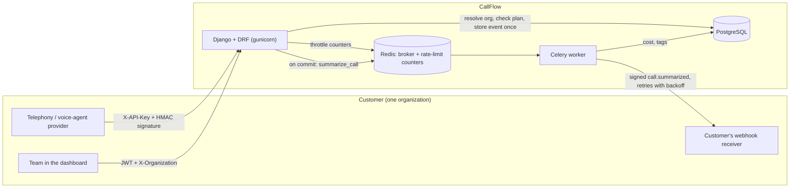
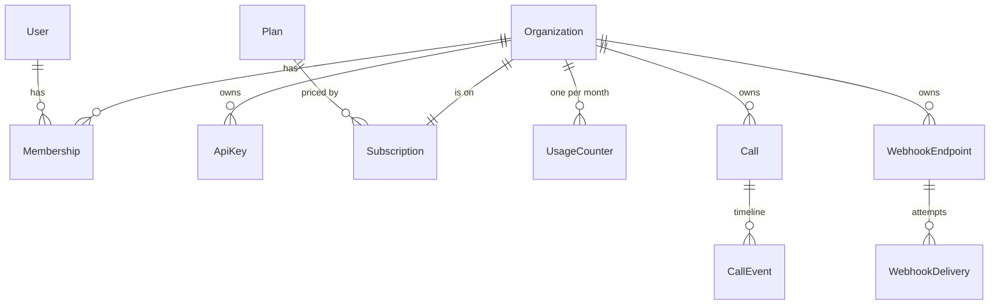

# CallFlow API

[](https://github.com/Vedansh-0611/callflow-analytics-api/actions/workflows/ci.yml)

**CallFlow is a multi-tenant call analytics service for AI voice agents.** A company plugs its
telephony or voice-agent provider into CallFlow's signed webhook. CallFlow stores every call with
its event timeline, works out what each call cost (LLM tokens plus telephony minutes) and how it
ended, then shows it on a dashboard and pushes a signed `call.summarized` event back to the
company's own systems.

This repo is the backend: Django, Django REST Framework, Celery, PostgreSQL and Redis.

- **Dashboard:** [callflow-dashboard](https://github.com/Vedansh-0611/callflow-dashboard), live demo
  at **https://vedansh-0611.github.io/callflow-dashboard/** (demo mode, mock data, no backend needed)
- **API docs:** `/api/docs/` (Swagger UI) and `/api/redoc/` on any running instance

## Features

| Area | What it does |
|------|--------------|
| **Multi-tenancy** | Organizations with owner / admin / member roles. Every call, event, key, endpoint and usage row belongs to one org; querysets are always filtered by the request's org. Tests prove one org cannot read, guess or modify another's data. |
| **Auth** | Email/password signup and login returning JWTs (dashboard). Org API keys for servers: shown once, stored as SHA-256 hashes, looked up by prefix, revocable. |
| **Signed, idempotent ingestion** | `POST /api/webhooks/calls/` needs the org's API key **and** an HMAC-SHA256 signature made with the org's webhook secret. Duplicate `event_id`s return `200 duplicate`, so provider retries are safe. Secrets rotate with a 24 h grace period. |
| **Async processing** | When a call ends, a Celery task computes cost and outcome tags (`resolved`, `transferred`, `tool_failed`, `booking_made`...), queued only after the transaction commits. |
| **Rate limits** | Per-API-key throttle from the org's plan (Free 60/min, Pro 600/min) with counters in Redis, per-user and per-IP login limits, and a 64 KB cap on webhook bodies (413). |
| **Plans and metering** | Free and Pro plans. Calls and billed minutes are metered per month. A new call past the limit gets a **402** with a machine-readable body; calls already in progress can still finish. Plan changes go through a `BillingProvider` interface (fake provider included, Stripe hook point documented). |
| **Outbound webhooks** | Orgs register endpoints for `call.summarized`. Deliveries are stored, signed like inbound webhooks, and retried by Celery with exponential backoff and jitter. Test pings and a delivery log are available. |
| **Operations** | OpenAPI schema, `/api/health/` and `/api/ready/`, JSON logs with request ids that follow a request into Celery, env-gated Sentry, security headers, whitenoise, gunicorn, a multi-stage non-root Docker image and a Render blueprint. |

## Architecture



**One webhook, end to end**

1. `ApiKeyAuthentication` finds the key by its prefix and checks the hash: this says *which org*.
2. The per-key throttle (plan-based, Redis) runs; oversized bodies are refused with 413.
3. The HMAC signature over `"<timestamp>.<raw body>"` is checked against the org's current (or
   just-rotated) secret, with a 5-minute replay window: this says *the body is genuine*.
4. In one transaction: a retry of a known `event_id` returns `200 duplicate` right away; a new
   call is checked against the plan (402 if over) and metered; the call row is locked, the event
   stored, the call updated.
5. After commit, `summarize_call` is queued and the API answers `202`.
6. The worker computes cost and tags. On the first summary it stores one `WebhookDelivery` per
   subscribed endpoint (unique per event id) and `deliver_webhook` sends it, retrying failures
   after 30 s, 60 s, 120 s and so on, up to 5 retries.

**Tenancy model**



## API quickstart

Start the stack and create a demo org, user and API key:

```bash
docker compose up --build -d
docker compose exec web python manage.py seed      # prints the login, API key and webhook secret
export CALLFLOW_API_KEY=cf_xxxxxxxx_...           # from the seed output
export CALLFLOW_WEBHOOK_SECRET=whsec_...
```

Send a signed event:

```bash
BODY='{"event_id":"evt_001","type":"call.started","call_id":"call_demo_1","timestamp":"2026-01-10T10:00:00Z","data":{"agent_id":"clinic-receptionist","direction":"inbound"}}'
TS=$(date +%s)
SIG=$(printf '%s.%s' "$TS" "$BODY" | openssl dgst -sha256 -hmac "$CALLFLOW_WEBHOOK_SECRET" | awk '{print $NF}')

curl -X POST http://localhost:8000/api/webhooks/calls/ \
  -H "Content-Type: application/json" \
  -H "X-API-Key: $CALLFLOW_API_KEY" \
  -H "X-Webhook-Timestamp: $TS" \
  -H "X-Webhook-Signature: sha256=$SIG" \
  -d "$BODY"
# 202 {"status":"accepted","event_id":"evt_001"}    send it again: 200 {"status":"duplicate"}
```

Or send a whole call (start, transcript, tool call, end, plus a retry) with
`python scripts/send_event.py`.

Read data with the same key:

```bash
curl -H "X-API-Key: $CALLFLOW_API_KEY" "http://localhost:8000/api/calls/?status=completed&ordering=-cost_usd"
curl -H "X-API-Key: $CALLFLOW_API_KEY" "http://localhost:8000/api/calls/call_demo_1/"
curl -H "X-API-Key: $CALLFLOW_API_KEY" "http://localhost:8000/api/stats/?days=7"
```

Dashboard-style access with a JWT:

```bash
TOKEN=$(curl -s -X POST http://localhost:8000/api/auth/login/ -H 'Content-Type: application/json' \
  -d '{"email":"demo@callflow.dev","password":"callflow-demo"}' | python3 -c 'import sys,json;print(json.load(sys.stdin)["access"])')
curl -H "Authorization: Bearer $TOKEN" -H "X-Organization: demo" http://localhost:8000/api/billing/
```

Register an endpoint for `call.summarized` (the response shows its signing secret once):

```bash
curl -X POST http://localhost:8000/api/webhook-endpoints/ -H "Authorization: Bearer $TOKEN" \
  -H 'Content-Type: application/json' -d '{"url":"https://example.com/hooks/callflow"}'
```

When a plan limit is hit:

```
HTTP 402
{"detail": "The Free plan includes 500 calls per month and this month's are used up. Upgrade the plan to keep ingesting new calls.",
 "code": "plan_limit_exceeded", "limit": "monthly_calls", "plan": "free", "used": 500, "allowed": 500}
```

### Endpoints

| Area | Endpoints |
|------|-----------|
| Auth | `POST /api/auth/signup/`, `POST /api/auth/login/`, `POST /api/auth/refresh/`, `GET /api/auth/me/` |
| Orgs | `GET/POST /api/orgs/`, `GET /api/orgs/current/`, `GET/POST /api/orgs/current/webhook-secret/` (view / rotate) |
| API keys | `GET/POST /api/api-keys/`, `DELETE /api/api-keys/<id>/` (revoke) |
| Ingestion | `POST /api/webhooks/calls/` (API key + signature) |
| Analytics | `GET /api/calls/` (filters, search, ordering, pagination), `GET /api/calls/<id>/`, `GET /api/stats/?days=` |
| Outbound | `/api/webhook-endpoints/` CRUD, `POST .../<id>/rotate-secret/`, `POST .../<id>/test/`, `GET .../<id>/deliveries/` |
| Billing | `GET /api/billing/`, `POST /api/billing/change-plan/` |
| Ops | `GET /api/health/`, `GET /api/ready/`, `/api/schema/`, `/api/docs/`, `/api/redoc/` |

Roles: members can read analytics and usage. Owners and admins also manage keys, secrets,
endpoints and the plan. API keys can ingest and read, never manage the org.

## Running it

**Docker Compose** (production image and settings, over plain http):

```bash
make up          # web (gunicorn), worker (Celery), Postgres, Redis + seed data
make logs        # JSON logs; follow one request with its request_id
```

**Local virtualenv** (SQLite, no Redis, tasks run inline):

```bash
make install && cp .env.example .env    # set CELERY_TASK_ALWAYS_EAGER=true
make migrate && make seed && make run   # http://localhost:8000/api/docs/
```

**Checks:**

```bash
make test        # pytest (SQLite, Celery eager)
make lint        # ruff
make schema      # OpenAPI schema must validate with zero warnings
```

CI runs ruff, the migration check, schema validation and the test suite on PostgreSQL 16, then
builds the Docker image, boots the full stack and exercises it from outside: readiness, signed
ingestion through the worker, 401s without credentials, JWT login and the docs page.

## Deploy to Render

`render.yaml` describes the whole stack: the web service (Docker, `docker/entrypoint.sh web`
runs migrations then gunicorn), a Celery worker, PostgreSQL and a Key Value (Redis) instance.

1. Fork or push this repo to your GitHub account.
2. In Render: **New > Blueprint**, pick the repo, and apply. Render generates
   `DJANGO_SECRET_KEY` and wires `DATABASE_URL` and `REDIS_URL`.
3. Optional: set `SENTRY_DSN` on the shared env group.
4. Seed a demo workspace from the web service's **Shell** tab: `python manage.py seed`.
5. Point the dashboard at it: build `callflow-dashboard` with
   `VITE_API_URL=https://<your-service>.onrender.com`, and keep that origin in
   `CORS_ALLOWED_ORIGINS` (the blueprint already allows the GitHub Pages origin).

Render's free tier has no background workers. To stay at $0, delete the worker from the
blueprint and set `CELERY_TASK_ALWAYS_EAGER=true` on the web service: tasks then run inside the
request. Free instances also sleep when idle, so the first request after a while is slow.

## Design decisions and trade-offs

**Shared database, `organization_id` on every row.** Simpler to run and migrate than a schema or
database per tenant, and fine at this scale. The risk is a query that forgets the filter, so
scoping lives in one mixin (`OrgScopedQuerysetMixin`), the default permission resolves the org on
every request, and a view without it fails closed (no `request.organization`, so an error, not
another tenant's rows). Ids from providers are unique *per org*, and every index leads with
`organization_id` because every query filters by it. Postgres row-level security would be the
next layer of defence.

**API key and signature, not one or the other.** The key identifies the org and can be revoked
on its own; the HMAC proves the body is unchanged and recent. A leaked key alone cannot forge
events, and a leaked secret alone does not say which org to target.

**SHA-256 for API keys, not bcrypt.** Keys are 160 random bits, so there is nothing to brute
force, and a fast hash keeps auth cheap on every request. The prefix (`cf_1a2b3c4d`) is indexed
for a single-row lookup and safe to show in the UI. `last_used_at` is written at most once a
minute so reads do not turn into writes.

**Idempotency in the database.** `(organization, event_id)` is a unique constraint, the check
happens inside a transaction with the call row locked, and an `IntegrityError` from a race is
treated as a duplicate. Duplicates are answered *before* the plan check, so a retry of an
accepted event can never get a 402.

**402 for quotas, 429 for rate.** 429 means "slow down, try again shortly"; 402 means "this will
keep failing until the plan changes". Only new calls are refused, so a call is never cut off
halfway. The check-then-increment is not locked, so under heavy concurrency an org can go a few
calls over; that soft limit is a deliberate trade for not serializing all ingestion per org.

**Outbound delivery is a stored row first.** `WebhookDelivery` is written before anything is
sent, unique on `(endpoint, event_id)`, and the task skips deliveries that already succeeded. So
re-running a summary or a task never double-sends, and the log shows every attempt. Receivers
get the event id in `X-CallFlow-Delivery` to dedupe on their side too.

**Billing behind an interface.** `BillingProvider.change_plan()` is the only way plans change and
`services.apply_plan()` is the only place it is written. A Stripe provider would return a
checkout URL and grant the plan from Stripe's webhook, without touching views or limits.

**Migrating to tenancy safely.** Adding `organization` was split into two migrations: add a
nullable column and backfill existing rows into a Default org, then make it required and swap
the unique constraints. That is the pattern that works on a live table.

**SSRF basics.** In production, endpoint URLs must be https and cannot be localhost, `.internal`
or private / link-local IP literals. DNS-resolution checks are on the roadmap.

**Plain secrets for HMAC.** Webhook secrets must be readable to verify signatures, so they are
stored as-is (never in logs or the admin). Encrypting them at rest with a KMS key is the next step.

## Roadmap

- Invitations and member management (invite by email, change roles, remove)
- Auto-disable endpoints after repeated failures, and manual redelivery from the log
- Stripe provider and its webhook behind the existing `BillingProvider`
- Postgres row-level security as a second tenancy guard; KMS-encrypted secrets
- DNS-based SSRF protection for endpoint URLs
- Audit log (who created or revoked a key, rotated a secret, changed the plan)
- Prometheus metrics (ingest latency, queue depth, delivery success rate)

## Project layout

```
config/          settings, URLs, Celery app
core/            request ids, JSON logging, health/readiness, OpenAPI auth extension
accounts/        organizations, memberships, API keys, JWT auth views, tenancy and throttles
billing/         plans, subscriptions, usage metering, BillingProvider
calls/           models, signed ingestion, cost and outcome rules, stats, summarize task
outbound/        webhook endpoints, deliveries, signed delivery task with backoff
docker/          entrypoint (web | worker)
tests/           pytest: tenancy, auth, API keys, throttling, billing, outbound, ingestion, ops
render.yaml      Render blueprint (web, worker, Postgres, Redis)
```
